# MSS301 Assignment 02 – Watch Management Microservices

**Student:** DE190100  
**Báo cáo:** Saga Pattern – Test Evidence  
**Ngày hoàn thiện evidence:** 05/11/2026

## Environment

| Thành phần | Cấu hình kiểm thử |
|---|---|
| Hệ điều hành | Windows, Docker Desktop và Docker Compose |
| Runtime | Java 21 / Spring Boot microservices |
| Database | SQL Server 2022 chạy bằng Docker; volume dữ liệu được giữ nguyên |
| Công cụ | Postman, Visual Studio Code debugger, SQL Server Management Studio |
| API Gateway | `localhost:8080` |
| MSAccount | `localhost:8081` |
| MSBrand | `localhost:8082` |
| MSWatch | `localhost:8083` |
| SQL Server | `localhost:1433` |

Trong quá trình thu thập bằng chứng, không reset database, không xóa volume và không chạy lại collection khi không cần thiết. Sau khi lấy evidence breakpoint, tiến trình MSWatch chạy local debug đã được dừng và container `ms-watch` được khởi động lại.

## System Architecture

Luồng truy cập chính là **Postman/Client → API Gateway → các microservice**. API Gateway định tuyến đến MSAccount, MSBrand và MSWatch. MSWatch đóng vai trò **Saga Orchestrator**, lưu `Watches`, `SagaStates`, `SagaLogs` trong DBWatch; MSBrand là **Saga Participant**, quản lý liên kết `BrandWatches` trong DBBrand. Mỗi bước là một local transaction; khi lỗi xảy ra trước pivot, orchestrator gọi các bước bù theo thứ tự ngược (LIFO), thay vì sử dụng distributed transaction.

Các luồng chính được kiểm tra:

- CREATE: `CREATE_WATCH → ASSIGN_BRAND`; bù `UNASSIGN_BRAND → DELETE_WATCH`.
- UPDATE: cập nhật watch và brand; khi lỗi thì khôi phục brand cũ trước, sau đó khôi phục watch.
- DELETE: `UNASSIGN_BRAND → DELETE_WATCH`. `DELETE_WATCH` là pivot; sau khi pivot commit, saga chỉ được phép tiến về phía trước.

## Docker Deployment Evidence

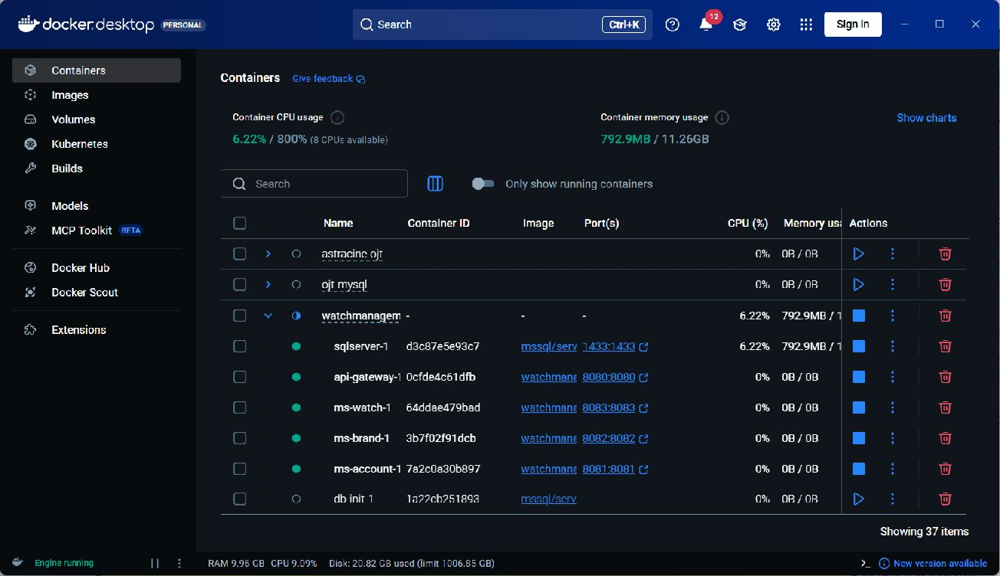

Ảnh cho thấy stack cuối cùng đã được khôi phục: SQL Server, API Gateway, MSAccount, MSBrand và MSWatch đều có trạng thái running. `db-init` là container one-shot nên đã hoàn tất và dừng là trạng thái mong đợi. Không sử dụng `docker compose down -v` và không xóa volume.

## Postman Automated Test Result

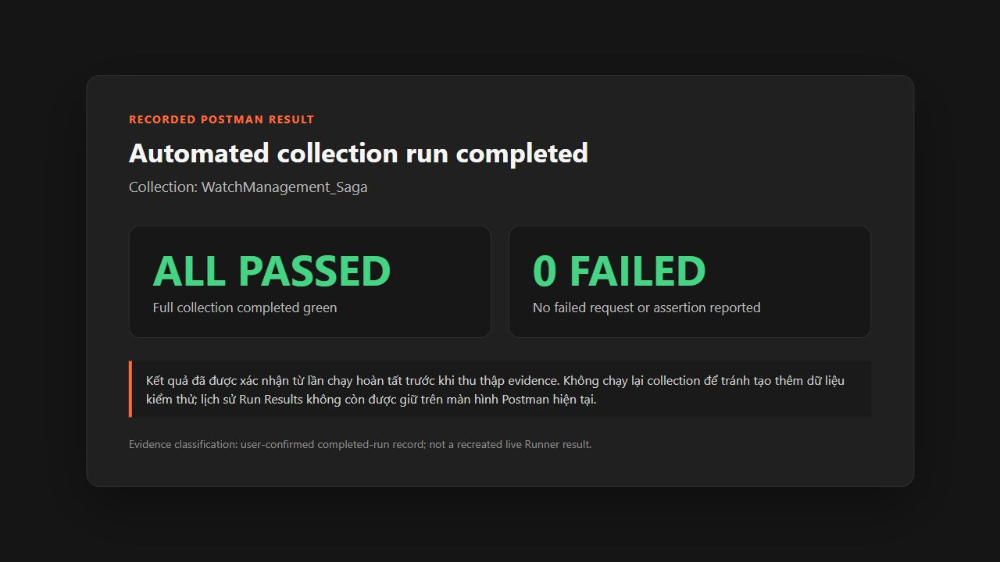

Collection `WatchManagement_Saga` đã chạy full green với **0 failed** trước thời điểm thu thập evidence. Vì lịch sử Run Results không còn được giữ trên màn hình Postman hiện tại, ảnh trên là phiếu ghi nhận minh bạch từ kết quả đã hoàn tất do người thực hiện xác nhận; collection không được chạy lại để tránh phát sinh dữ liệu kiểm thử mới. Các ảnh response và saga detail bên dưới là bằng chứng trực tiếp còn tồn tại trong Postman/ứng dụng.

## Saga CREATE Evidence

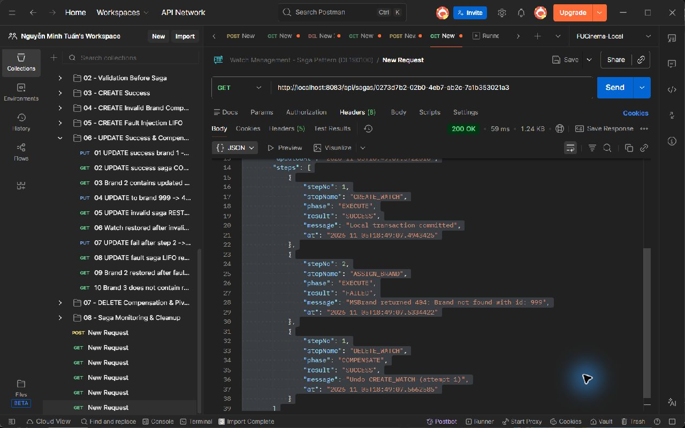

Với brand không hợp lệ, saga ghi nhận `CREATE_WATCH / EXECUTE / SUCCESS`, tiếp theo `ASSIGN_BRAND / EXECUTE / FAILED`, rồi thực hiện `DELETE_WATCH / COMPENSATE / SUCCESS`. Watch vừa tạo được xóa bù, tránh để lại dữ liệu mồ côi trong DBWatch.

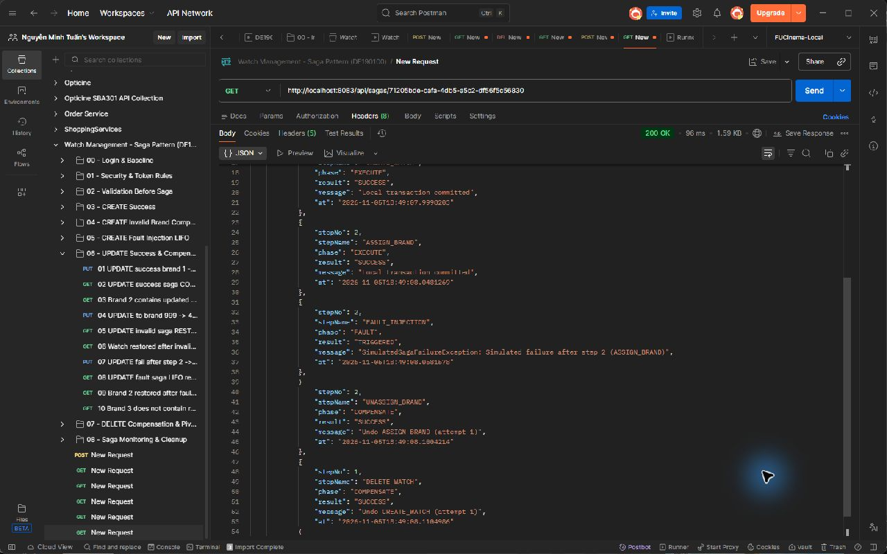

Khi fault được kích hoạt sau hai bước thành công, log thể hiện thứ tự bù LIFO đúng: `UNASSIGN_BRAND` chạy trước `DELETE_WATCH`. Đây là bằng chứng trực tiếp rằng các local transaction đã hoàn tất được hoàn tác theo thứ tự ngược.

## Saga UPDATE Evidence

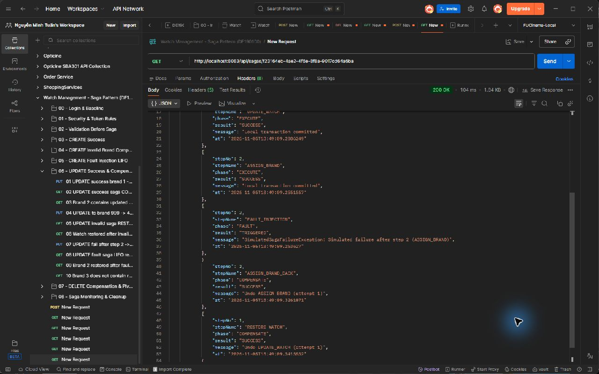

Saga UPDATE ghi nhận `UPDATE_WATCH` và `ASSIGN_BRAND` thành công trước khi fault injection được kích hoạt. Sau đó hệ thống bù theo thứ tự `ASSIGN_BRAND_BACK` rồi `RESTORE_WATCH`, khôi phục cả liên kết brand và dữ liệu watch về trạng thái trước cập nhật.

## Saga DELETE / Pivot Evidence

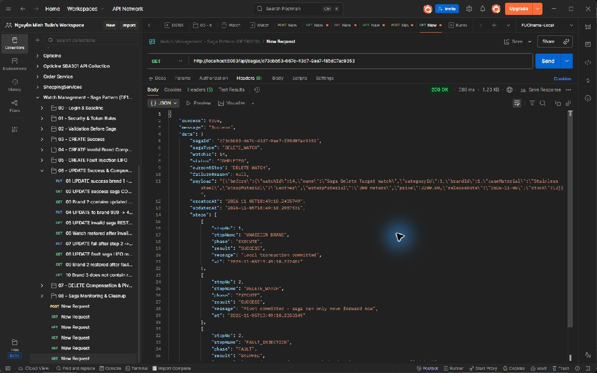

Saga DELETE hoàn tất `UNASSIGN_BRAND / EXECUTE / SUCCESS`, sau đó `DELETE_WATCH / EXECUTE / SUCCESS`. Log ghi rõ pivot đã commit và saga chỉ có thể tiến về phía trước; fault injection sau pivot bị bỏ qua. Quy tắc này ngăn việc cố rollback một thao tác xóa đã được xác định là điểm không thể quay lại.

## Scenario 6.3 – MSBrand Network Failure

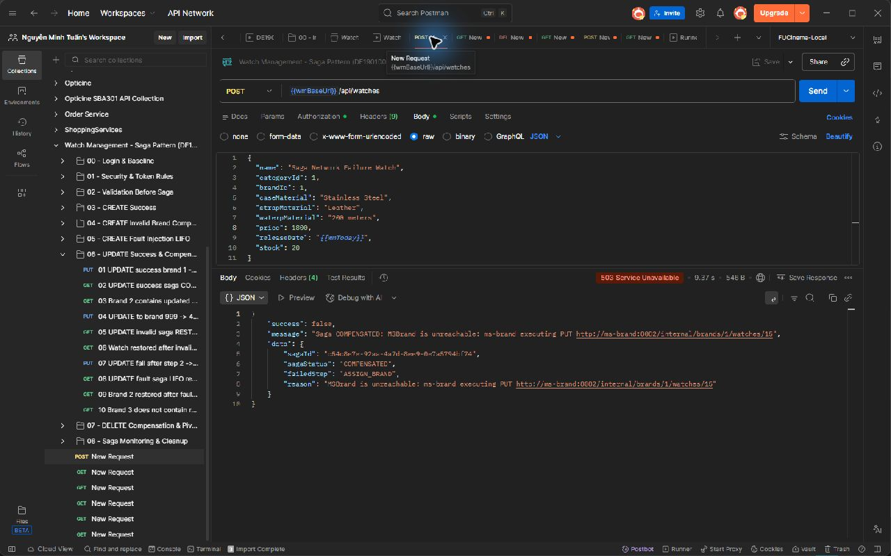

CREATE khi MSBrand không truy cập được trả về **HTTP 503 Service Unavailable**. Response nêu rõ `MSBrand is unreachable`, `sagaStatus = COMPENSATED` và `failedStep = ASSIGN_BRAND`.

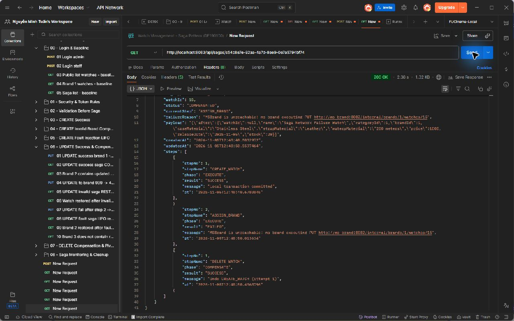

Saga detail xác nhận chuỗi xử lý: `CREATE_WATCH / EXECUTE / SUCCESS → ASSIGN_BRAND / EXECUTE / FAILED → DELETE_WATCH / COMPENSATE / SUCCESS`. Trạng thái cuối là `COMPENSATED`; local transaction đã tạo watch được hoàn tác thành công khi participant không khả dụng.

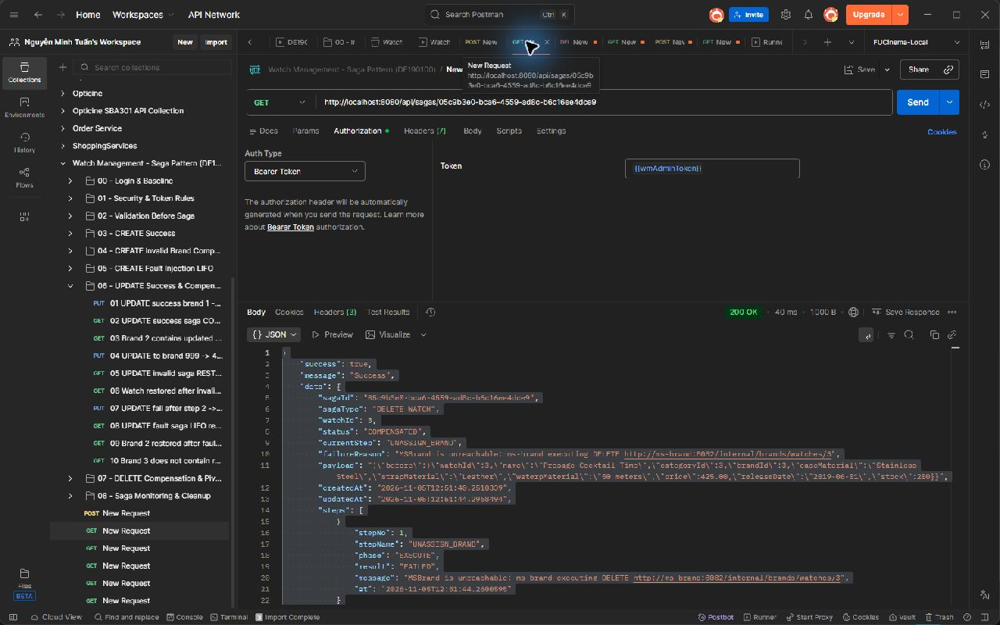

Với yêu cầu DELETE watch 3 khi MSBrand down, saga chỉ ghi nhận `UNASSIGN_BRAND / EXECUTE / FAILED`. `DELETE_WATCH` không được gọi, vì bước trước pivot chưa thành công; do đó dữ liệu watch không bị xóa nhầm.

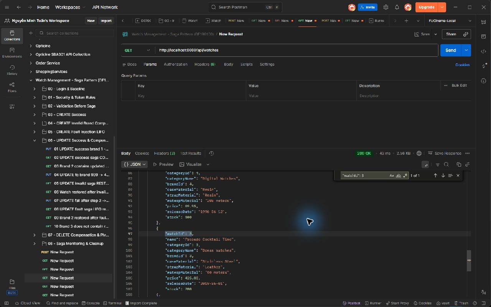

Kết quả truy vấn watch list vẫn tìm thấy `watchId = 3`, chứng minh DELETE đã dừng an toàn trước pivot và watch 3 còn tồn tại.

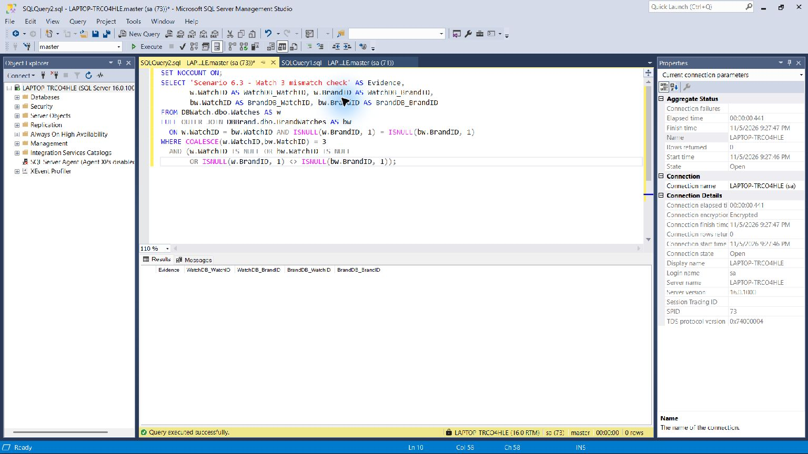

Truy vấn read-only so sánh DBWatch và DBBrand cho watch 3 trả về **0 rows** trong tập mismatch. Điều này chứng minh hai database vẫn nhất quán sau lỗi mạng ở kịch bản 6.3.

## Scenario 6.4 – Compensation Failure

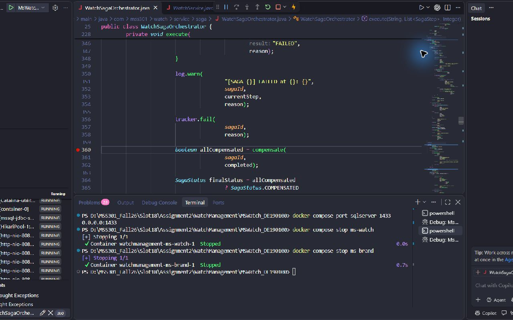

Debugger dừng ngay tại dòng gọi `compensate(sagaId, completed)`, tức breakpoint được đặt trước khi bắt đầu chuỗi compensation. Bằng chứng này xác nhận vị trí quan sát đúng theo yêu cầu kịch bản.

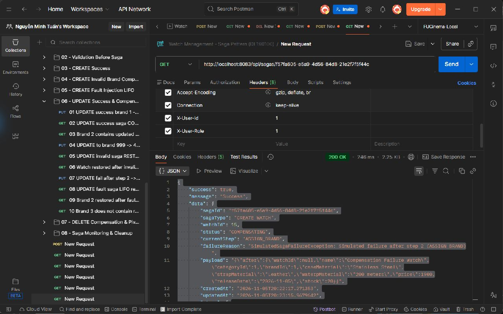

Response fault-injection cho thấy saga của watch 15 không thể hoàn tất compensation và trả trạng thái `COMPENSATING`; lỗi phát sinh sau `ASSIGN_BRAND`, vì vậy các bước đã hoàn tất cần được bù theo LIFO.

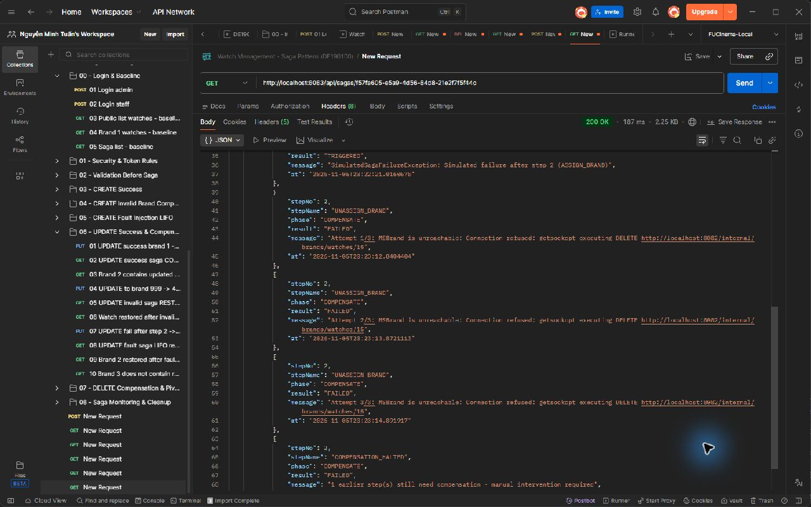

Saga log ghi đầy đủ `CREATE_WATCH / SUCCESS`, `ASSIGN_BRAND / SUCCESS`, `FAULT_INJECTION / TRIGGERED`, sau đó `UNASSIGN_BRAND / COMPENSATE / FAILED` ở **Attempt 1/3, 2/3 và 3/3**. Cuối log là `COMPENSATION_HALTED / FAILED`. Không có `DELETE_WATCH / COMPENSATE` sau đó: orchestrator dừng chuỗi bù khi bước bù gần nhất thất bại, giữ trạng thái `COMPENSATING` để cảnh báo cần can thiệp thủ công.

Ảnh ghi nhận đúng trạng thái database hiện tại của watch 15: truy vấn mismatch trả về **1 row**; watch còn trong DBWatch nhưng không có liên kết tương ứng trong DBBrand. Đây không phải kết quả “consistent”; nó là bằng chứng hậu quả của compensation bị halt và phù hợp với trạng thái `COMPENSATING`/manual intervention required. Báo cáo không tự suy diễn hoặc che giấu sai lệch này.

## Cross-Database Consistency

| Kịch bản | Đối tượng | Kết quả truy vấn mismatch | Kết luận |
|---|---:|---:|---|
| 6.3 – MSBrand network failure | watch 3 | 0 rows | DBWatch và DBBrand nhất quán; DELETE dừng trước pivot |
| 6.4 – compensation failure | watch 15 | 1 row | Có sai lệch: DBWatch còn watch, DBBrand thiếu link; cần xử lý thủ công/recovery |

Hai truy vấn chỉ đọc dùng `FULL OUTER JOIN` theo `WatchID` và `BrandID` để phát hiện bản ghi chỉ tồn tại ở một database hoặc khác brand. Không có câu lệnh cập nhật/xóa dữ liệu nào được thực thi khi thu thập evidence.

## Final Checklist

- [x] Đủ 15 file evidence với tên thống nhất trong `docs/evidence/`.
- [x] Docker cuối phiên: API Gateway, MSAccount, MSBrand, MSWatch và SQL Server đều running; SQL Server healthy.
- [x] MSBrand đã được start lại.
- [x] MSWatch local debug đã dừng; Docker `ms-watch` đã được start lại.
- [x] Không chạy `docker compose down -v`, không reset database và không xóa volume.
- [x] Không sửa source code nghiệp vụ.
- [x] Không thay đổi `.env`, password, JWT secret hoặc cấu hình bảo mật.
- [x] Không commit hoặc push Git.
- [x] Ảnh và báo cáo không chứa token/password/secret thực; chỉ có tên biến hoặc placeholder khi cần mô tả.
- [x] Mọi ảnh Markdown dùng đường dẫn tương đối `evidence/<file>.png` và đã được kiểm tra tồn tại.
- [x] Kết quả 6.4 được ghi đúng là inconsistent hiện tại, không được trình bày sai thành pass consistency.

## Conclusion

Bộ evidence chứng minh các Saga CREATE, UPDATE và DELETE tuân thủ thứ tự EXECUTE/COMPENSATE, compensation chạy LIFO và DELETE pivot ngăn rollback không hợp lệ. Kịch bản 6.3 xử lý lỗi mạng an toàn bằng HTTP 503, bù CREATE thành công và giữ watch 3 khi DELETE chưa qua bước đầu. Kịch bản 6.4 chứng minh cơ chế retry ba lần, dừng compensation đúng chỗ và duy trì trạng thái `COMPENSATING` để lộ rõ nhu cầu manual recovery. Stack đã được đưa về trạng thái Docker hoạt động đầy đủ mà không reset dữ liệu.
